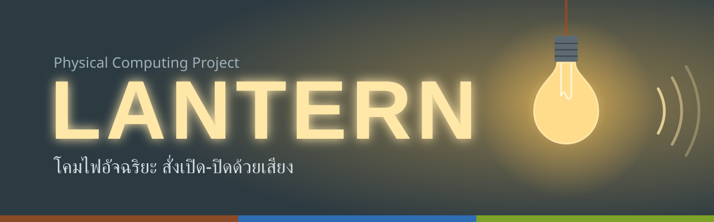
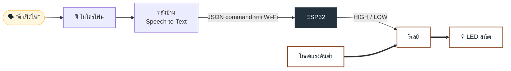

<p align="center">
  
</p>

<p align="center">
  
  
  
  
  
</p>

<p align="center">
  <b><a href="https://weloveptae.github.io/lantern/">ดูเว็บพรีเซนต์</a></b>
</p>

---

## LANTERN คืออะไร

**LANTERN** คือระบบสั่งงานอุปกรณ์ภายในบ้านด้วยเสียงแบบ hands-free แค่เรียกชื่อ **“ตี๋”** แล้วต่อด้วย **“เปิด”** หรือ **“ปิด”** ระบบจะส่งคำสั่งจาก backend ไปยัง ESP32 เพื่อควบคุมอุปกรณ์สาธิตแรงดันต่ำ โดยยังไม่รองรับการต่อโหลดไฟบ้านโดยตรง

| ปัญหา | ทางแก้ของเรา |
| --- | --- |
| นอนอยู่บนเตียงแล้วต้องลุกไปปิดไฟ | พูดสั่งได้จากตรงที่อยู่ |
| ถือของอยู่ มือไม่ว่าง | ไม่ต้องใช้มือเลย |
| ผู้สูงอายุเดินไปกดสวิตช์ลำบาก | สั่งด้วยเสียงแทนการเดินไปกด |

## การทำงาน



1. ผู้ใช้พูดคำปลุก **“ตี๋”** แล้วต่อด้วย **“เปิด”** หรือ **“ปิด”**
2. ไมโครโฟนส่งเสียงให้หลังบ้าน ซึ่งแปลงเสียงเป็นข้อความด้วย Speech-to-Text
3. หลังบ้านเช็กว่ามีคำว่า “ตี๋” ไหม ถ้ามี ดูคำสั่งเปิดหรือปิด แล้วส่ง JSON command ให้ ESP32 ผ่าน Wi-Fi ถ้าไม่มีคำปลุกหรือคำสั่งไม่ชัดเจนจะไม่ทำอะไร
4. ESP32 ตรวจสอบ `accepted=true` และส่งคำสั่งไปยังอุปกรณ์สาธิตแรงดันต่ำผ่าน RelayController
5. การทดสอบใน repository นี้ใช้ LED หรือโหลด DC แรงดันต่ำเท่านั้น

> ฝั่งสั่งงาน (ไมค์, backend และ ESP32) ใช้ไฟต่ำ และการทดสอบ relay ใน repository นี้ใช้โหลด DC แรงดันต่ำเท่านั้น

## อุปกรณ์

| อุปกรณ์ | ใช้ทำอะไร | จำนวน |
| --- | --- | :---: |
| ESP32 DevKit V1 | รับคำสั่งจาก backend และควบคุมอุปกรณ์ | 1 |
| INMP441 | รับเสียงพูดของผู้ใช้ | 1 |
| คอมพิวเตอร์ (backend) | แปลงเสียงเป็นข้อความและตรวจคำสั่ง | 1 |
| โมดูลรีเลย์ 5V | ควบคุมโหลดแรงดันต่ำสำหรับการสาธิต | 1 |
| LED หรือโหลด DC แรงดันต่ำ | โหลดสำหรับทดสอบ | 1 |
| LCD 16x2 I2C (optional) | แสดงสถานะระบบ | 1 |
| สายจัมเปอร์ / บอร์ดทดลอง | ต่อวงจรแรงดันต่ำ | 1 ชุด |

## ⚠️ ความปลอดภัย

การทดสอบของโครงการนี้จำกัดอยู่ที่วงจรแรงดันต่ำเท่านั้น ห้ามต่อไฟบ้านหรือสายไฟเปลือยเข้ากับ relay module หรือ breadboard

- ทดสอบด้วย LED หรือโหลด DC แรงดันต่ำเท่านั้น
- ห้ามจ่าย 5V เข้าขา GPIO ของ ESP32
- Relay module ต้องมีวงจรขับที่เหมาะสมและใช้แหล่งจ่ายตามสเปก
- การติดตั้งโหลดไฟบ้านต้องใช้อุปกรณ์หุ้มป้องกันที่ได้มาตรฐานและช่างไฟฟ้าที่มีคุณสมบัติ

## เว็บพรีเซนต์

เว็บอยู่ที่ [`index.html`](index.html) เป็นหน้าเดียว ส่วนการทำงานมีแผนผังที่ชี้หรือแตะแต่ละกล่องและเส้นเพื่อดูรายละเอียดได้ คลิกหลอดไฟในหน้าแรกเพื่อเปิด-ปิดไฟบนจอ

รันในเครื่อง:

```bash
python3 -m http.server
# แล้วเปิด http://localhost:8000
```

## เครดิตรูปภาพ

รูปอุปกรณ์ในแผนผังมาจาก Wikimedia Commons ตัดพื้นหลังและย่อขนาดแล้ว (ไฟล์ใน `assets/flow/`)

| รูป | ที่มา | ผู้สร้าง | สัญญาอนุญาต |
| --- | --- | --- | --- |
| อุปกรณ์ควบคุม | [Arduino Uno R4 Minima perspective](https://commons.wikimedia.org/wiki/File:Arduino_Uno_R4_Minima_perspective.webp) | Arduino | CC BY-SA 3.0 |
| รีเลย์ | [SRD-05VDC-SL-C 5V one-channel relay module](https://commons.wikimedia.org/wiki/File:SRD-05VDC-SL-C_5V_one-channel_relay_module.jpg) | Suyash.dwivedi | CC BY-SA 4.0 |
| หลอดไฟ | [Incandescent bulb, frosted](https://commons.wikimedia.org/wiki/File:Incandescent_bulb,_frosted.jpg) | Kotivalo | CC BY-SA 4.0 |
| ไมโครโฟน | [USB-Microphone](https://commons.wikimedia.org/wiki/File:USB-Microphone.jpg) | Evan-Amos | Public domain |
| โน้ตบุ๊ก | [Toshiba Satellite Pro (white background)](https://commons.wikimedia.org/wiki/File:Toshiba_Satellite_Pro_(white_background).jpg) | Smial | Free Art License |
| ปลั๊ก | [Type C Europlug](https://commons.wikimedia.org/wiki/File:Type_C_Europlug.jpg) | Wikimedia Commons user | CC0 |

รูป 3D หลอดไฟหน้าแรก และไอคอนในส่วนอุปกรณ์/ทีม มาจาก [3dicons.co](https://3dicons.co) (CC0)

## ทีม

| | ชื่อ | รหัสนักศึกษา | หน้าที่ |
| :---: | --- | --- | --- |
| 🟤 | ชื่อ นามสกุล | 68070013 | หัวหน้าทีม |
| 🔵 | ชื่อ นามสกุล | 68070014 | เขียนโค้ด |
| 🟢 | ชื่อ นามสกุล | 68070006 | ต่อวงจร |
| 🟡 | ชื่อ นามสกุล | 680700xx | ออกแบบชิ้นงาน |
| ⚫ | ชื่อ นามสกุล | 680700xx | เอกสาร / พรีเซนต์ |

---

<p align="center"><sub>LANTERN · วิชา Physical Computing ภาคเรียนที่ 1/2569</sub></p>
