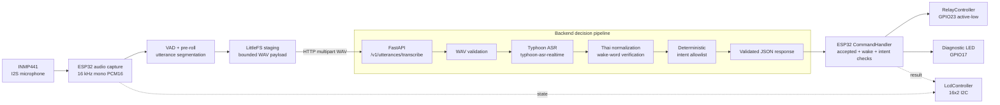

# Lantern

**ระบบสั่งงานบ้านด้วยเสียงภาษาไทยแบบ Hands-free สำหรับ Smart Home Prototype แรงดันต่ำ**

Lantern รวม ESP32, ไมโครโฟน INMP441 แบบ I2S, FastAPI backend และ Typhoon ASR เพื่อแปลงคำพูดภาษาไทยเป็นคำสั่งอุปกรณ์ที่ผ่านการตรวจสอบ ระบบปัจจุบันควบคุม LED หรือ relay สำหรับโหลดแรงดันต่ำ และแสดงสถานะผ่าน LCD 16x2 I2C ได้

> หมวดหมู่: Embedded Systems · IoT · Voice AI · Smart Home
>
> สถานะ: พัฒนา Phase 0–6 แล้วในระดับที่แตกต่างกัน ระบบนี้เป็น prototype ยังไม่ใช่ผลิตภัณฑ์ Smart Home เชิงพาณิชย์ที่ผ่านการรับรอง

<p align="center">
  
</p>

<p align="center">
  <a href="https://weloveptae.github.io/lantern/">ดูเว็บไซต์นำเสนอ</a>
</p>

## สารบัญ

- [ภาพรวม](#ภาพรวม)
- [ความสามารถและสถานะ](#ความสามารถและสถานะ)
- [สถาปัตยกรรม](#สถาปัตยกรรม)
- [Technology Stack](#technology-stack)
- [การต่อ Hardware](#การต่อ-hardware)
- [โครงสร้าง Repository](#โครงสร้าง-repository)
- [เริ่มต้นใช้งาน](#เริ่มต้นใช้งาน)
- [การตั้งค่า](#การตั้งค่า)
- [ลำดับการทำงาน](#ลำดับการทำงาน)
- [การทดสอบ](#การทดสอบ)
- [สถานะการพัฒนา](#สถานะการพัฒนา)
- [ข้อจำกัดและความปลอดภัย](#ข้อจำกัดและความปลอดภัย)
- [งานในอนาคต](#งานในอนาคต)
- [เครดิตและ License](#เครดิตและ-license)

## ภาพรวม

Lantern ออกแบบมาสำหรับสถานการณ์ที่ผู้ใช้ไม่สะดวกเดินไปกดสวิตช์ เช่น กำลังถือของ พักผ่อนอยู่ หรือจำเป็นต้องใช้ระบบแบบไม่ต้องกดปุ่ม ผู้ใช้พูด wake phrase ตามด้วยคำสั่ง เช่น `เปิดไฟ` หรือ `ปิดไฟ`

ระบบแยกขั้นตอนสำคัญออกจากกันอย่างชัดเจน:

1. **ASR** แปลงเสียงเป็นข้อความ โดย template ของ Lantern ตั้งค่าให้ใช้ Typhoon OpenAI-compatible transcription API
2. **Wake-word verification** ตรวจคำปลุกใน transcript ปัจจุบันเป็นการตรวจที่ backend ยังไม่ใช่ wake-word model บน ESP32
3. **Intent detection** normalize ข้อความภาษาไทย แล้วตรวจด้วย allowlist เช่น `LIGHT_ON` และ `LIGHT_OFF`
4. **Device actuation** ESP32 จะสั่งอุปกรณ์เมื่อ response มี `accepted=true`, พบ wake word, เป็น intent ที่รองรับ และไม่ใช่ request ซ้ำ

Wake phrase หลักคือ **`ตี๋`** และรองรับคำทางเลือก เช่น `tee`, `ตี`, `ที` โดยค่า production ต้องมี wake phrase เสมอ แม้ backend จะมีโหมดชั่วคราวที่อนุญาตคำสั่งชัดเจนโดยไม่ต้องมี wake word แต่ ESP32 จะยังปฏิเสธ response ที่มี `wake_word_detected=false`

## ความสามารถและสถานะ

| ความสามารถ | สถานะ | รายละเอียด |
| --- | --- | --- |
| Hands-free audio capture | Implemented | ไม่ต้องใช้ push-to-talk หรือปุ่มกด |
| INMP441 I2S microphone | Implemented | รับเสียง mono ที่ 16 kHz |
| VAD และ segmentation | Implemented | ใช้ frame 20 ms, pre-roll, silence endpoint และขอบเขต recording |
| Typhoon ASR | Implemented | File transcription ด้วย model `typhoon-asr-realtime` |
| ASR provider abstraction | Implemented | รองรับ mock, hosted Typhoon และมี boundary สำหรับ self-host |
| Wake-word verification | Implemented | ตรวจ transcript หลัง Thai text normalization |
| Deterministic intents | Implemented | `LIGHT_ON`, `LIGHT_OFF`, `FAN_ON`, `FAN_OFF` และ safe rejection |
| ESP32 device control | Implemented | ควบคุม diagnostic LED และ relay สำหรับ light intent ที่ผ่านการยืนยัน |
| Wi-Fi และ HTTP recovery | Implemented | มี bounded reconnect, timeout, retry และ request identity |
| Duplicate/replay protection | Implemented | มี cache ที่ backend และ executed-request cache บน ESP32 |
| LCD 16x2 I2C | Implemented | แสดง state, scan address และ diagnostic firmware |
| Latency instrumentation | Implemented | วัดเวลาที่ backend และ firmware จนถึง GPIO command |
| LLM agent | Experimental | มีโค้ดแยกและปิดไว้เป็นค่าเริ่มต้น ยังไม่ใช่ control baseline ที่ verified |

Physical verification ต้องแยกจาก software verification ผู้ใช้รายงานว่า LCD diagnostic และ relay/lamp ใน setup ที่ใช้งานแสดงผล/ทำงานได้ แต่ relay reset behavior, chatter, GPIO boot state, ค่า I2C pull-up และการต่อ GPIO23 ปัจจุบันยังต้องตรวจสอบทางไฟฟ้าเพิ่มเติม การ build สำเร็จไม่ใช่หลักฐานว่า hardware ปลอดภัย

## สถาปัตยกรรม



### หน้าที่ของ ESP32

- อ่านเสียงจาก INMP441 ผ่าน I2S อย่างต่อเนื่อง
- ทำ lightweight filtering และ voice/activity gate
- เก็บ pre-roll 300 ms และบันทึก utterance ที่มีขอบเขตลง LittleFS
- เชื่อมต่อ Wi-Fi ใหม่ด้วย bounded attempts และ exponential backoff
- ส่ง WAV หนึ่ง utterance ผ่าน HTTP โดยใช้ request ID เดิมเมื่อ retry
- ปฏิเสธ response ที่ invalid, ซ้ำ, ไม่มี wake word หรือเป็น intent ที่ไม่รองรับก่อนเปลี่ยน output
- แสดงสถานะบน LCD และ Serial Monitor โดยไม่บันทึกเสียงถาวรเป็นค่าเริ่มต้น

### หน้าที่ของ Backend

- ตรวจว่า WAV เป็น mono, 16 kHz, PCM16
- เรียก ASR provider และ normalize transcript ภาษาไทย
- ตรวจ wake phrase และเลือก intent จาก allowlist
- ป้องกัน duplicate audio และ request ID replay
- ส่ง structured response กลับไปยัง ESP32

เนื่องจาก wake word ปัจจุบันตรวจจากข้อความ ASR เสียงที่ไม่ใช่คำสั่งอาจถูกส่งไปยัง ASR ก่อนถูกปฏิเสธ

## Technology Stack

### Hardware

- ESP32 DevKit V1 / ESP32-WROOM-32 class board
- INMP441 digital I2S microphone
- SONGLE SRD-05VDC-SL-C relay module สำหรับการทดสอบแรงดันต่ำ
- LCD 16x2 ที่ใช้ HD44780-compatible controller และ I2C backpack
- LED หรือ DC load แรงดันต่ำสำหรับสาธิต

### Firmware

- C++ และ Arduino Core for ESP32
- PlatformIO
- ESP32 I2S และ `Wire` I2C APIs
- LittleFS สำหรับ staging audio แบบมีขอบเขต
- LCD และ relay controller ที่แยกเป็นโมดูล

### Backend

- Python 3.10–3.14 (`backend/pyproject.toml` กำหนด `<3.15`)
- FastAPI และ Uvicorn
- `uv` สำหรับจัดการ dependencies และ lock file
- `sounddevice`, NumPy และ `webrtcvad-wheels` สำหรับ PC microphone tool
- pytest และ HTTPX สำหรับ automated tests

### Speech และ command processing

- Typhoon ASR hosted API, model `typhoon-asr-realtime`
- OpenAI-compatible file transcription interface
- Thai text normalization และ transcript-level wake-word verification
- Deterministic intent matching พร้อม rejection สำหรับคำสั่งกำกวม/ปฏิเสธ/ขัดแย้ง
- Optional LLM/tool-calling path เป็น experimental และปิดไว้เป็นค่าเริ่มต้น

## การต่อ Hardware

ค่าต่อไปนี้อ้างอิงจาก [`lantern_config.h`](Embedded%20System/include/lantern_config.h) และ source ปัจจุบัน

| อุปกรณ์ | สัญญาณ | GPIO / ค่า | หน้าที่ |
| --- | --- | --- | --- |
| Diagnostic LED | Anode ผ่าน resistor | GPIO17 | Low-voltage demo output |
| INMP441 | BCLK / SCK | GPIO26 | I2S clock |
| INMP441 | WS / LRCLK | GPIO25 | I2S word select |
| INMP441 | SD / DOUT | GPIO33 | I2S data input |
| INMP441 | L/R | GND | เลือก left channel |
| Relay module | Signal `S` | GPIO23 | Active-low control |
| LCD backpack | SDA | GPIO18 | I2C data |
| LCD backpack | SCL | GPIO19 | I2C clock |
| LCD backpack | Address | `0x27` preferred | scan ตอนเริ่มต้น |

ห้ามจ่าย coil ของ relay จาก GPIO ESP32 โดยตรง Coil ต้องใช้แหล่งจ่ายตามสเปกของ module และต้องตรวจสอบว่า input ของ module รับ logic 3.3 V ได้อย่างเสถียรหรือไม่ นอกจากนี้ต้องตรวจสอบ pull-up ของ LCD backpack เพราะ GPIO ESP32 ไม่ควรถูกต่อเข้ากับ I2C pull-up 5 V ที่ไม่เหมาะสม

การพัฒนาต้องใช้ protected low-voltage load เท่านั้น ห้ามต่อสายไฟ AC ที่เปิดโล่งเข้ากับ breadboard, jumper หรือ relay ที่ยังไม่ได้ทำ enclosure การใช้งานไฟบ้านต้องใช้อุปกรณ์ switching ที่ป้องกันและมีพิกัดถูกต้อง พร้อมการติดตั้ง/ตรวจสอบโดยช่างไฟฟ้าที่มีคุณสมบัติ

## โครงสร้าง Repository

```text
lantern/
├── README.md
├── AGENTS.md
├── .gitignore
├── index.html                 # หน้าเว็บนำเสนอ
├── assets/                    # รูปภาพและ SVG ของหน้าเว็บ
├── backend/
│   ├── app/
│   │   ├── main.py            # FastAPI routes และ pipeline orchestration
│   │   ├── audio.py           # WAV/PCM16 validation และ conversion
│   │   ├── config.py           # settings จาก environment
│   │   ├── schemas.py          # response contract
│   │   └── services/           # ASR, VAD, wake, intent, replay modules
│   ├── scripts/               # microphone, Typhoon และ mock benchmark
│   ├── tests/                 # backend regression tests
│   ├── pyproject.toml
│   ├── uv.lock
│   └── .env.example
├── Embedded System/
│   ├── include/                # configuration และ controller APIs
│   ├── src/                    # ESP32 application และ controller sources
│   ├── tests/                  # firmware policy tests บน host
│   ├── platformio.ini          # esp32dev และ diagnostic environments
│   ├── build.ps1               # Windows PlatformIO wrapper
│   ├── upload_monitor.py       # upload/serial-monitor helper
│   └── .env.example             # firmware build-time settings
└── docs/                       # local architecture และ verification reports
```

ไฟล์ generated เช่น `.pio/`, `.uv-cache/`, runtime audio, local secrets และ build artifacts จะไม่รวมอยู่ใน source tree ที่เผยแพร่

## เริ่มต้นใช้งาน

### Prerequisites

- Python 3.10 ขึ้นไป แนะนำ Python 3.12 สำหรับ PlatformIO บน Windows
- [`uv`](https://docs.astral.sh/uv/)
- PlatformIO CLI หรือคำสั่ง `uv` ที่ repository จัดเตรียมไว้
- ESP32 DevKit V1 และ INMP441 สำหรับ physical testing
- Typhoon API key สำหรับ hosted transcription

### 1. ตั้งค่า Backend

จาก root ของ repository:

```powershell
Set-Location backend
uv sync --dev
Copy-Item .env.example .env
```

แก้ไข `backend/.env` และใส่ `TYPHOON_API_KEY` จริง โดยเก็บไฟล์ `.env` ไว้ในเครื่องเท่านั้น สำหรับ production voice path ให้ใช้:

```dotenv
ASR_PROVIDER=typhoon_api
REQUIRE_WAKE_WORD=true
WAKE_PHRASE=ตี๋
WAKE_WORD_ALTERNATIVES=tee,ตี,ที
```

เปิด FastAPI ให้ ESP32 เข้าถึงคอมพิวเตอร์ผ่าน LAN หรือ hotspot ได้:

```powershell
uv run uvicorn app.main:app --host 0.0.0.0 --port 8000
```

ตรวจสอบ service จากอีก terminal:

```powershell
Invoke-RestMethod http://127.0.0.1:8000/health
```

ผลลัพธ์ที่คาดหวัง:

```json
{"status":"ok"}
```

ต้องรันคำสั่ง backend จากโฟลเดอร์ `backend/` เพราะ settings โหลด `.env` จาก current working directory

### 2. ตั้งค่า Firmware

Firmware มี configuration แยกจาก backend:

```powershell
Set-Location 'Embedded System'
Copy-Item .\include\secrets.example.h .\include\secrets.h
Copy-Item .\.env.example .\.env
```

แก้ `include/secrets.h` ด้วยชื่อ Wi-Fi, password และ IP ของคอมพิวเตอร์ที่รัน backend ห้ามใช้ `127.0.0.1` เป็น `LANTERN_BACKEND_HOST` เพราะจะชี้กลับไปที่ ESP32 เอง `secrets.h` เป็นไฟล์ local และห้าม commit

### 3. Build Firmware หลัก

Environment สำหรับ firmware production คือ `esp32dev` และต้อง quote path เพราะชื่อโฟลเดอร์มีช่องว่าง:

```powershell
Set-Location 'Embedded System'
.\build.ps1 run -e esp32dev
```

คำสั่งแบบตรง:

```powershell
uv run --python 3.12 --with platformio platformio run -e esp32dev
```

Upload ไปยัง board เช่น `COM7`:

```powershell
.\build.ps1 run -e esp32dev -t upload --upload-port COM7
```

เปิด Serial Monitor:

```powershell
.\build.ps1 device monitor -e esp32dev -b 115200 --port COM7
```

หรือใช้ Python helper สำหรับ upload และ monitor พร้อมกัน:

```powershell
python .\upload_monitor.py --environment esp32dev --port COM7 --mode both
```

### 4. Diagnostic environments

Environment เหล่านี้แยกจาก voice pipeline:

```powershell
.\build.ps1 run -e relay_test
.\build.ps1 run -e lcd_test
.\build.ps1 run -e lcd_state_test
```

`relay_test` ทดสอบ relay GPIO, `lcd_test` scan I2C และแสดง `LANTERN TEST` / `LCD READY`, ส่วน `lcd_state_test` cycle display state โดยไม่เริ่ม relay, microphone, Wi-Fi หรือ backend

### 5. การทดสอบแรงดันต่ำ

1. ตรวจสอบการต่อ ESP32, microphone, LCD และ relay ตาม mapping ด้านบน
2. ใช้ LED หรือ DC load แรงดันต่ำเท่านั้น
3. ตรวจ Serial Monitor ว่ามี Wi-Fi, audio/VAD, backend, accepted intent และ relay state
4. ตรวจว่า response ที่ rejected หรือ duplicate ไม่ทำให้ relay เปลี่ยนสถานะ
5. แยกการตรวจ relay contact ออกจาก software test เพราะ firmware log ได้เพียง GPIO command ไม่ใช่เวลาที่หน้าสัมผัสเปลี่ยนจริง

## การตั้งค่า

### Backend `.env`

Template หลักคือ [`backend/.env.example`](backend/.env.example)

| ตัวแปร | ค่าเริ่มต้น/ตัวอย่าง | หน้าที่ |
| --- | --- | --- |
| `ASR_PROVIDER` | `typhoon_api` | เลือก `mock`, hosted Typhoon หรือ self-host mode ที่ยัง reserved |
| `TYPHOON_API_KEY` | ว่าง | credential ของ Typhoon ต้องเก็บใน `.env` local เท่านั้น |
| `TYPHOON_API_BASE_URL` | `https://api.opentyphoon.ai/v1` | OpenAI-compatible API base URL |
| `TYPHOON_ASR_MODEL` | `typhoon-asr-realtime` | ASR model |
| `TYPHOON_API_TIMEOUT_S` | `30` | provider timeout |
| `REQUIRE_WAKE_WORD` | `true` | บังคับให้มี wake phrase ก่อนตรวจ intent |
| `WAKE_PHRASE` | `ตี๋` | wake phrase หลักใน transcript |
| `WAKE_WORD_ALTERNATIVES` | `tee,ตี,ที` | wake phrase ทางเลือกคั่นด้วย comma |
| `SAVE_UPLOADED_AUDIO` | `false` | เปิดใช้เมื่อยอมรับการเก็บ WAV ในเครื่องเท่านั้น |
| `MAX_AUDIO_BYTES` | `1000000` | ขนาด upload สูงสุด |
| `DUPLICATE_WINDOW_S` | `30` | ช่วงเวลาป้องกัน audio ซ้ำ |
| `REQUEST_REPLAY_WINDOW_S` | `60` | ช่วงเวลาสำหรับ request-ID replay |

### Firmware settings

`Embedded System/.env.example` ถูกอ่านตอน build โดย `load_env.py`:

| ตัวแปร | ค่าเริ่มต้น | ค่าที่รองรับ/หน้าที่ |
| --- | --- | --- |
| `MAX_RECORDING_MS` | `4000` | integer ตั้งแต่ `1000` ถึง `60000` ms |
| `RELAY_ACTIVE_LOW` | `true` | `true` สำหรับ relay active-low ปัจจุบัน หรือ `false` สำหรับ active-high |

GPIO และ preferred LCD address เป็น compile-time definitions ใน `include/lantern_config.h` ส่วน Wi-Fi และ backend host อยู่ใน `include/secrets.h`

## ลำดับการทำงาน

ตัวอย่างคำสั่ง **“ตี๋ เปิดไฟ”**:

1. ESP32 อ่านเสียงจาก INMP441 ที่ 16 kHz ตรวจ speech เก็บ pre-roll และจบ utterance ตาม endpoint ที่ตั้งไว้
2. ESP32 สร้าง mono PCM16 WAV และ upload ไป FastAPI พร้อม header `X-Lantern-Request-ID`
3. FastAPI ตรวจ WAV แล้วส่งไฟล์ให้ Typhoon ASR
4. Backend normalize transcript, ตรวจ `ตี๋` และแปลง `เปิดไฟ` เป็น `LIGHT_ON`
5. Backend ส่ง response เช่น:

   ```json
   {
     "wake_word_detected": true,
     "matched_wake_word": "ตี๋",
     "request_id": "esp32-example-1",
     "intent": {
       "name": "LIGHT_ON",
       "parameters": {"output": "demo_led"},
       "accepted": true,
       "reason": "allowlisted command"
     }
   }
   ```

6. ESP32 `CommandHandler` ตรวจ response, กันคำสั่งซ้ำ และเรียก `RelayController` กับ diagnostic LED เฉพาะ light command ที่ accepted
7. LCD แสดงสถานะ เช่น `RECORDING`, `PROCESSING`, `LIGHT ON` หรือ `COMMAND NO`

เมื่อ `REQUIRE_WAKE_WORD=true` คำว่า **“เปิดไฟ”** โดยไม่มี `ตี๋` จะถูก ignore/reject และต้องไม่เปลี่ยน output เช่นเดียวกับคำสั่งที่ขัดแย้ง, ปฏิเสธ, malformed หรือไม่รองรับ การเปลี่ยน GPIO เป็นสิ่งที่ software ตรวจได้ ส่วน relay contact ต้องตรวจด้วย hardware แรงดันต่ำแยกต่างหาก

## การทดสอบ

### Backend tests

```powershell
Set-Location backend
uv run pytest
uv run python -m compileall -q app scripts
```

Tests ใช้ mocked ASR/LLM services จึงไม่ใช้ paid Typhoon request สำหรับการทดสอบทั่วไป PC microphone tool ทำงานแบบ hands-free ระดับ utterance:

```powershell
uv run python -m scripts.test_realtime_asr --help
uv run python -m scripts.test_realtime_asr --list-devices
uv run python -m scripts.test_realtime_asr --provider typhoon_api
```

สามารถเพิ่ม `--device`, `--vad-sensitivity`, `--pre-roll-ms`, `--silence-timeout-ms`, `--max-recording-ms` หรือ `--save-wav <directory>` ได้ โดยจะไม่บันทึก WAV เป็นค่าเริ่มต้น

### Mock pipeline benchmark

```powershell
uv run python -m scripts.benchmark_pipeline --iterations 5
```

Benchmark นี้ใช้ `MockASRProvider` และ FastAPI `TestClient` จึงไม่ใช่ค่าความเร็วของ microphone, Wi-Fi, Typhoon จริง, ESP32 หรือ relay contact

### Firmware host tests และ builds

```powershell
Set-Location 'Embedded System'
python -m unittest discover -s tests -p 'test_*.py'
.\build.ps1 run -e esp32dev
.\build.ps1 run -e relay_test
.\build.ps1 run -e lcd_test
.\build.ps1 run -e lcd_state_test
```

ผลตรวจสอบล่าสุดใน workspace: firmware host tests ผ่าน 23 tests, backend tests ผ่าน 62 tests และ build `esp32dev`, `relay_test`, `lcd_test`, `lcd_state_test` สำเร็จ Backend มี Starlette/httpx deprecation warning 1 รายการแต่ไม่มี test failure ควรรันคำสั่งซ้ำบนเครื่องและ toolchain ที่ใช้งานจริง เพราะผลเหล่านี้ไม่ใช่หลักฐานการทำงานของ hardware จริง

## สถานะการพัฒนา

| Phase | ขอบเขต | การประเมินปัจจุบัน |
| --- | --- | --- |
| 0 | Repository และ backend scaffolding | Implemented |
| 1 | PC microphone, VAD และ Typhoon file transcription | Implemented; physical microphone/API ขึ้นกับเครื่องและ credential |
| 2 | ESP32 INMP441 capture และ HTTP audio upload | Implemented; long-running hardware/network validation ยังขึ้นกับสภาพแวดล้อม |
| 3–3.5 | Wake word, deterministic intent, retry และ deduplication | Implemented และมี automated tests |
| 4 | Relay/device-controller integration | Software implemented; GPIO23 และ electrical behavior ต้องตรวจ low-voltage ต่อเนื่อง |
| 5 | Latency instrumentation และ reliability | Implemented ในระดับ source/build/test; ยังไม่ประกาศ complete live end-to-end benchmark |
| 6 | LCD I2C state feedback | Implemented; ผู้ใช้รายงานว่า LCD diagnostic และ integration ทำงานที่ address `0x27` |
| 7 | Optional LLM/tool-calling agent | Experimental, ปิดไว้เป็นค่าเริ่มต้น และยังไม่ถือว่าเสร็จ |

## ข้อจำกัดและความปลอดภัย

- **พึ่งพา Network และ API:** คำสั่งอุปกรณ์ต้องให้ ESP32 ติดต่อคอมพิวเตอร์และ backend ติดต่อ ASR provider ได้
- **ความแปรผันของ ASR:** noise, การออกเสียง, ตำแหน่ง microphone และ transcript variation อาจทำให้ wake word หรือ intent ไม่ตรง
- **Wake word ระดับ transcript:** เสียงจะถูกส่งให้ ASR ก่อน backend จึงจะปฏิเสธคำที่ไม่มี wake phrase ได้ ยังไม่มี on-device wake-word model
- **Privacy:** ไม่บันทึกเสียงถาวรเป็นค่าเริ่มต้น การเปิด `SAVE_UPLOADED_AUDIO` หรือ `--save-wav` จะสร้างไฟล์เสียงในเครื่อง ผู้ใช้ต้องจัดการ retention เอง
- **Relay ตอน boot/reset:** Firmware ตั้งค่า relay เป็น logical OFF เร็วที่สุดเท่าที่ทำได้ แต่ควบคุม ROM bootloader, reset, brownout, floating GPIO หรือไฟเลี้ยงไม่เสถียรไม่ได้
- **Logic level:** ต้องตรวจ relay input, 5 V supply, driver circuit และ LCD pull-up ของ hardware จริง ห้ามนำ 5 V ต่อเข้า GPIO ESP32
- **ยังไม่รับรองไฟบ้าน:** การที่ lamp ติดดับไม่ใช่หลักฐานว่าระบบไฟฟ้าปลอดภัย ห้ามต่อสาย 220 V แบบเปิดโล่ง การใช้งานไฟบ้านต้องใช้อุปกรณ์ที่มี enclosure และพิกัดถูกต้อง พร้อมช่างไฟฟ้าที่มีคุณสมบัติ

## งานในอนาคต

รายการต่อไปนี้เป็น planned features ยังไม่ใช่ฟังก์ชันที่เสร็จสมบูรณ์:

- ทำ controlled Typhoon latency/accuracy evaluation ด้วยชุดประโยคภาษาไทยคงที่
- ทำ ESP32 Wi-Fi, heap, microphone และ reconnect soak test ระยะยาว
- เพิ่ม relay-state/contact sensing และ hardware default-OFF protection
- เพิ่มอุปกรณ์ Smart Home โดยยังใช้ explicit command allowlist
- ประเมิน LLM agent หลัง deterministic controls และ tool validation ทำหน้าที่เป็น safety boundary ได้ครบ
- ปรับปรุง command confirmation และ error recovery โดยไม่ block audio capture

## เครดิตและ License

Lantern ใช้ [Typhoon ASR documentation และ API](https://docs.opentyphoon.ai/en/asr/) สำหรับ hosted speech transcription ส่วน presentation assets มาจากเว็บไซต์นำเสนอเดิม และมีข้อมูล attribution อยู่ใน source/local project materials

ปัจจุบัน repository นี้ยังไม่มีไฟล์ `LICENSE` หากต้องการแจกจ่าย Lantern เป็น software ที่นำกลับไปใช้ซ้ำ ควรเพิ่ม license ที่ชัดเจนก่อน

หน้า presentation อยู่ที่ [`index.html`](index.html) สามารถ preview ในเครื่องได้ด้วย:

```powershell
python -m http.server
```

แล้วเปิด `http://localhost:8000`
